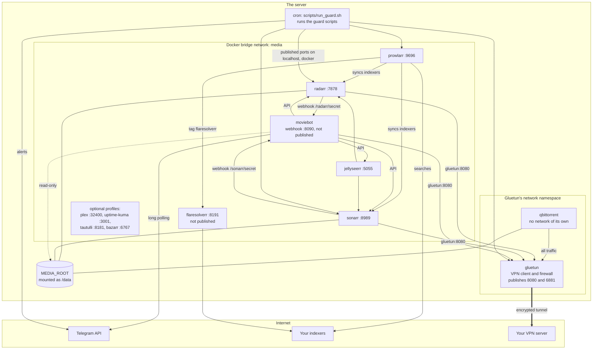

# Architecture

How the pieces of media-stack fit together: the containers and networks, how a request flows through them, where state lives, and the security model.

## The picture

## Containers

| Container | Image | Network | Port on the server | Media mount |
|---|---|---|---|---|
| `gluetun` | `qmcgaw/gluetun` | `media` | 8080 (qBittorrent web UI), 6881 TCP and UDP (torrent traffic) | none |
| `qbittorrent` | `lscr.io/linuxserver/qbittorrent` | Gluetun's namespace (`network_mode: service:gluetun`) | none of its own | `/data`, read-write |
| `radarr` | `lscr.io/linuxserver/radarr` | `media` | 7878 | `/data`, read-write |
| `sonarr` | `lscr.io/linuxserver/sonarr` | `media` | 8989 | `/data`, read-write |
| `prowlarr` | `lscr.io/linuxserver/prowlarr` | `media` | 9696 | none |
| `flaresolverr` | `ghcr.io/flaresolverr/flaresolverr` | `media` | none (8191 inside the network) | none |
| `jellyseerr` | `fallenbagel/jellyseerr` | `media` | 5055 | none |
| `moviebot` | built from `moviebot/` | `media` | none (8090 inside the network) | `/data`, read-only |
| `plex` (profile `plex`) | `lscr.io/linuxserver/plex` | `media` | 32400 | `/data`, read-only |
| `uptime-kuma` (profile `monitoring`) | `louislam/uptime-kuma:2` | `media` | 3001 | none |
| `tautulli` (profile `monitoring`) | `lscr.io/linuxserver/tautulli` | `media` | 8181 | none |
| `bazarr` (profile `subtitles`) | `lscr.io/linuxserver/bazarr` | `media` | 6767 | `/data`, read-write |

The container names are fixed, because the scripts and the app connections use them. Every container restarts unless you stopped it, and its log is rotated (10 MB, three files).

**One media mount.** `MEDIA_ROOT` on the server is mounted as `/data` in every container that handles media, and there are no separate mounts for its sub-folders. A hardlink only works inside one filesystem and one mount, so this is what lets Radarr and Sonarr import a finished download with an instant hardlink while it keeps seeding.

**Who talks to whom.**

| From | To | How |
|---|---|---|
| Radarr, Sonarr | qBittorrent | `gluetun:8080`, categories `radarr` and `sonarr` |
| Prowlarr | Radarr, Sonarr | `radarr:7878`, `sonarr:8989`, full sync of the indexers |
| Prowlarr | FlareSolverr | `flaresolverr:8191`, only for indexers with the tag `flaresolverr` |
| Radarr, Sonarr | the bot | webhook `moviebot:8090/<app>/<WEBHOOK_SECRET>` |
| Radarr, Sonarr | Plex | `PLEX_URL` with `PLEX_TOKEN`, to scan new files |
| Jellyseerr | Radarr, Sonarr, Plex | by container name, and `PLEX_URL` |
| The bot | Radarr, Sonarr, qBittorrent, Jellyseerr | by container name |
| The bot | Telegram | outgoing long polling: no port is opened for Telegram |
| The guard scripts | the apps | the published ports on localhost (`RADARR_URL`, `QBIT_URL` and the other `*_URL` settings), the Docker CLI, Telegram |
| Gluetun | your VPN server | the tunnel, which is qBittorrent's only way out |

## How a request flows

1. You send `Big Buck Bunny` to the bot in Telegram. The bot fetches new messages from Telegram itself (long polling), so it needs no open port.
2. The bot asks Radarr's and Sonarr's lookup and shows numbered results.
3. You tap the movie. The bot adds it to Radarr with the `HD-1080p` profile, in the library for its original language, and asks Radarr to search.
4. Radarr asks the indexers that Prowlarr synced into it. An indexer behind Cloudflare is reached through FlareSolverr. Radarr picks a release that fits the quality profile, the custom formats and the size cap.
5. Radarr sends the release to qBittorrent at `gluetun:8080`, with the category `radarr`. qBittorrent downloads it into `/data/downloads/movies`, and every byte goes through the VPN tunnel.
6. Radarr's Grab webhook reaches the bot at `moviebot:8090/radarr/<secret>`. The bot checks the release against Radarr's rules and tells you it is downloading, with a Cancel button. At the same moment the on-grab guard inside Radarr checks whether you already own the movie.
7. When the download finishes, Radarr imports it: a hardlink from `/data/downloads/movies/...` to `/data/movies/Big Buck Bunny (2008)/`, renamed by the naming rules. The torrent keeps seeding until a ratio of 2 or 3 days, whichever comes first, and then stops; Radarr then removes it from qBittorrent. The library copy is not affected.
8. Radarr tells Plex to scan (when Plex is set up), and sends its Download webhook to the bot, which tells you the movie is ready to watch.
9. Around it, the guard scripts keep watch: `verify_imports` probes the new file within half an hour, `regrab_guard` cancels a second copy, `malware_guard` and `dead_torrent_reaper` keep the download queue clean, and `vpn_watchdog` keeps qBittorrent's connection alive.

A show works the same way through Sonarr, except that the bot grabs a complete season pack for each finished season itself.

## Where state lives

| What | Where on the server | Notes |
|---|---|---|
| Settings and secrets | `.env` | Mode 600. Written by `install.sh`. Docker Compose reads it, and the host scripts read it through `scripts/settings.py`. |
| The apps' settings and databases | `config/<app>/` | One folder per container. Jellyseerr's is mounted at `/app/config`, Uptime Kuma's at `/app/data`, Gluetun's at `/gluetun`, the others at `/config`. |
| The on-grab guard | `config/radarr/ongrab/`, `config/sonarr/ongrab/`, `scripts/arr/arr.env` | Its log and cache; `arr.env` holds the folder names (written by `configure.py`). |
| The bot's state | `state/` (`STATE_DIR`), mounted as `/state` in the bot | `new_releases_seen.json`, `missing_fill.json`, `disk_alerts.json`. |
| The guards' state | `state/` | Small files whose names start with a dot, plus `tg_undelivered.log`. |
| Questions and answers | `state/confirms/` | `<id>.ask` and `<id>.reply`, shared by the bot and the host scripts. |
| Guard logs | `logs/` (`LOG_DIR`) | `logs/<job>.log`, about 5 MB at most each. |
| Backups | `backups/` (`BACKUP_DIR`) | Folder mode 700, files mode 600. Best on another disk. |
| Container logs | Docker | `docker logs <name>`. |
| The schedule | your user's crontab | Between `# >>> media-stack >>>` and `# <<< media-stack <<<`. |
| Your media | `MEDIA_ROOT` | Never moved, renamed or deleted by the installer. |

Apart from your media, the crontab and Docker's own storage (images and container logs), everything lives inside the stack folder, unless you point `STATE_DIR`, `LOG_DIR` or `BACKUP_DIR` elsewhere. `.env`, `config/`, `state/`, `logs/` and `backups/` are listed in `.gitignore`.

## Security model

- **The bot answers only you.** Only the Telegram user ids in `ALLOWED_TELEGRAM_USER_IDS` can use it, only in a private chat. Strangers get no reply at all, and their button taps do nothing. The bot refuses to start without an allow-list.
- **A secret webhook path.** Radarr and Sonarr call `/radarr/<WEBHOOK_SECRET>` and `/sonarr/<WEBHOOK_SECRET>`. The installer generates a long random secret, and the bot compares it in constant time and answers 403 to a wrong or missing one. The bot's logs never show the path, the token or the keys.
- **No published bot port.** The webhook port exists only on the internal `media` network. The bot reaches Telegram by polling out, so nothing from the internet can reach it.
- **The VPN kill switch.** qBittorrent has no network of its own: it lives in Gluetun's network namespace, and Gluetun's firewall only lets traffic out through the tunnel, except to the local networks listed in `FIREWALL_OUTBOUND_SUBNETS`. When Gluetun stops, qBittorrent has only a loopback interface left. qBittorrent does not start until Gluetun reports healthy. `tools/killswitch_test.sh` proves all of this on your machine.
- **Logins.** qBittorrent gets a random 20-character password. It skips its login only for requests from inside its own network namespace, which is how `setport.sh` sets the forwarded port. Radarr, Sonarr and Prowlarr ask you to create a login on first use.
- **Least privilege.** Every container runs with `no-new-privileges`, except Gluetun (it needs `NET_ADMIN` to build the tunnel and its firewall) and Uptime Kuma (its ping checks need the ping program's capability). The bot runs as `PUID`:`PGID`, not as root.
- **Secrets stay in `.env`.** It is mode 600 and in `.gitignore`. Backups are mode 600 in a mode 700 folder. The bot blanks secrets out of its log lines, and the host scripts' Telegram helper never logs a request URL, because it contains the bot token.
- **No telemetry.** Nothing phones home, and nothing updates itself. The only outgoing traffic is what the apps do themselves (for example Telegram, metadata lookups, the VPN and your indexers), plus three things. The installer downloads images, and Docker's install script only with `--install-docker` and your yes. `update_check` asks the image registries for digests once a week and downloads nothing. `tools/killswitch_test.sh` asks a public "what is my IP" service when you run it.
- **Media safety.** The installer never moves, renames or deletes media. The guards never delete a library file. What they remove is limited to downloads: dead or fake torrents, and program files in the download folders. Two optional features replace a library file, and both are off unless you turn them on: the space-saver (with a smaller copy) and the self-heal of `verify_imports` (an unreadable file, with a verified copy of the same download).
- **No remote access.** The web pages are plain HTTP for your own network. Keep them off the internet; use a VPN to your home if you need them while away.
